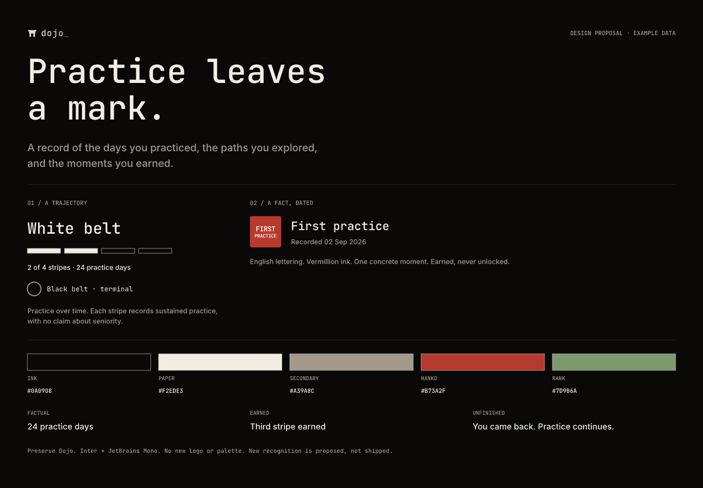
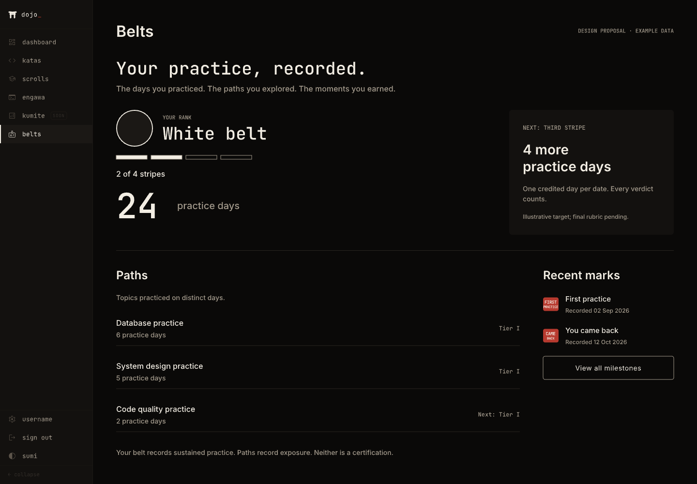
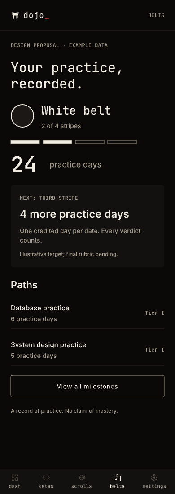
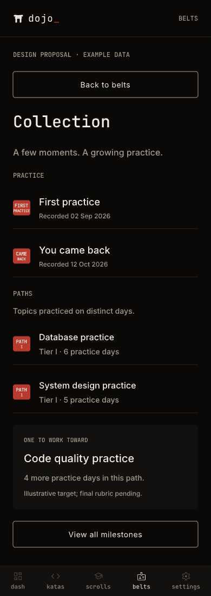
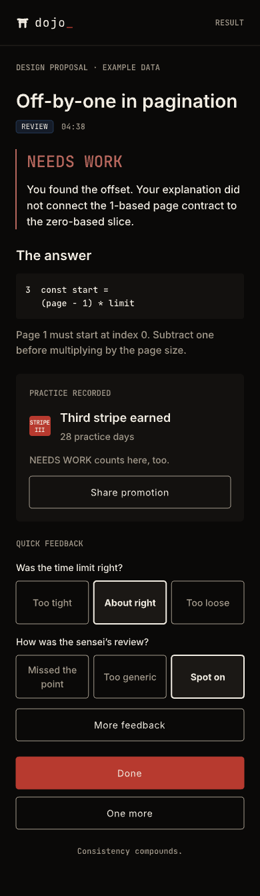
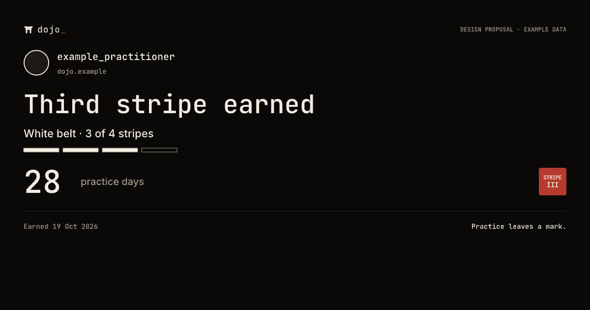

# Recognition — proposal gallery

These are Pencil exports with fictional example data, not running-app captures. The source is `design/_playground.pen`; the [brief and copy](../../brand/recognition.md) and [PRD-035](../../../docs/prd/035-recognition-revamp.md) define the proposal boundary. Export at 1× and rename by this map.

An independent visual review checked all six exports against the PRD and brand rules. Its two opportunities were applied: an explicit return from Collection and a terminal black-rank sample. Interaction and motion still require implementation checks.

| Artboard | Node | PNG |
|---|---|---|
| Recognition / Art direction / Proposal | `zOgzu` | [direction.png](direction.png) · 1440 × 1000 |
| Recognition / Progress desktop / Proposal | `SoxGT` | [progress-desktop.png](progress-desktop.png) · 1440 × 1000 |
| Recognition / Progress mobile / Proposal | `LgFua` | [progress-mobile.png](progress-mobile.png) · 390 × 1100 |
| Recognition / Collection mobile / Proposal | `O6Pjwf` | [collection-mobile.png](collection-mobile.png) · 390 × 1100 |
| Recognition / Result mobile / Proposal | `f06QD` | [result-mobile.png](result-mobile.png) · 390 × 1340, full scrollable content |
| Recognition / Promotion card / Proposal | `Tgluy` | [promotion-card.png](promotion-card.png) · 1200 × 630 |

