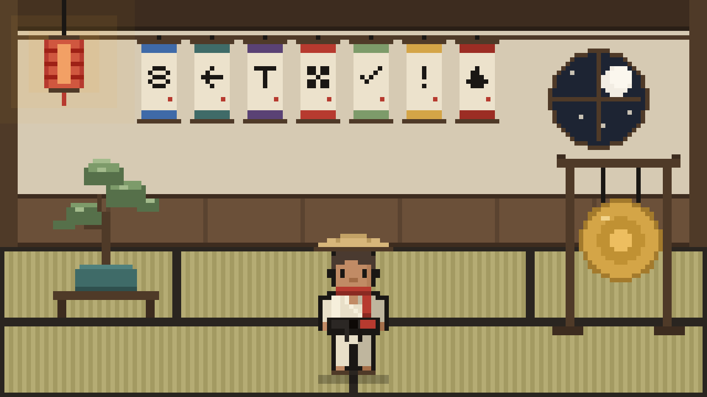
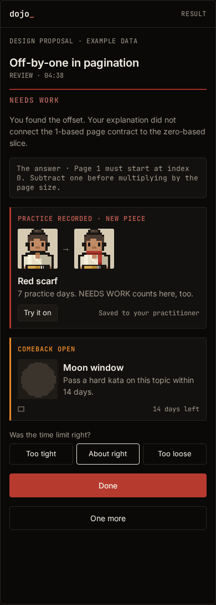
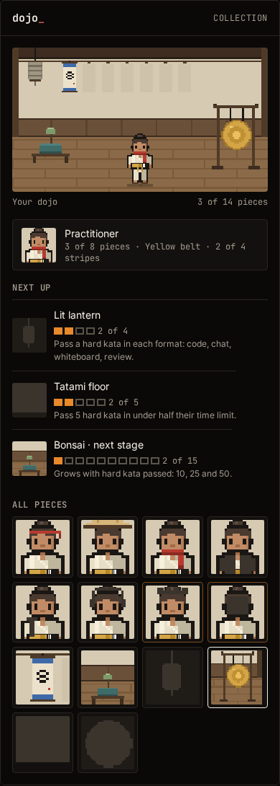

# Recognition — proposal gallery

Pixel direction (D66), with fictional example data. These are renders of the interactive prototype [`brand/proposals/practitioner/index.html`](../../brand/proposals/practitioner/index.html), not running-app captures and not Pencil exports: the `Recognition / Pixel / …` artboards in `_playground.pen` embed these files. Regenerate them from the prototype (`#full` for the furnished room); never redraw them on the canvas.

The Preserve direction (D63) that preceded it was removed; its artboards and exports remain in git at `fd3a36e`.

| Artboard | PNG |
|---|---|
| Recognition / Pixel / Practitioner desktop | [pixel-practitioner-desktop.png](pixel-practitioner-desktop.png) · 1440 × 3361 |
| Recognition / Pixel / Dojo desktop | [pixel-dojo-desktop.png](pixel-dojo-desktop.png) · 1440 × 3232 |
| Recognition / Pixel / Furnished room | [pixel-room-full.png](pixel-room-full.png) · 1280 × 720 |
| Recognition / Pixel / Share card | [pixel-share-card.png](pixel-share-card.png) · 1200 × 630 |
| Recognition / Pixel / Result mobile | [pixel-result-mobile.png](pixel-result-mobile.png) · 390 × 1090 |
| Recognition / Pixel / Collection mobile | [pixel-collection-mobile.png](pixel-collection-mobile.png) · 390 × 1090 |
| Recognition / Pixel / Piece · earned | [pixel-piece-earned.png](pixel-piece-earned.png) · 390 × 618 |
| Recognition / Pixel / Piece · locked | [pixel-piece-locked.png](pixel-piece-locked.png) · 390 × 563 |
| Recognition / Pixel / Piece · season preview | [pixel-piece-preview.png](pixel-piece-preview.png) · 390 × 622 |

